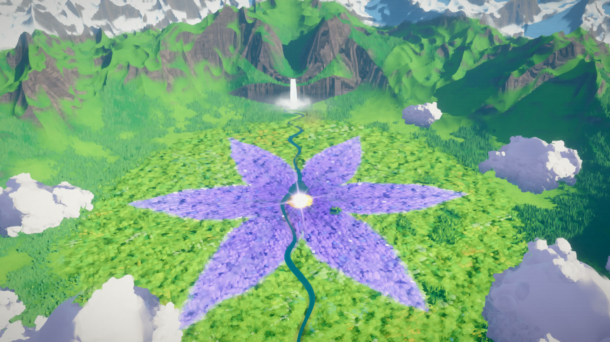
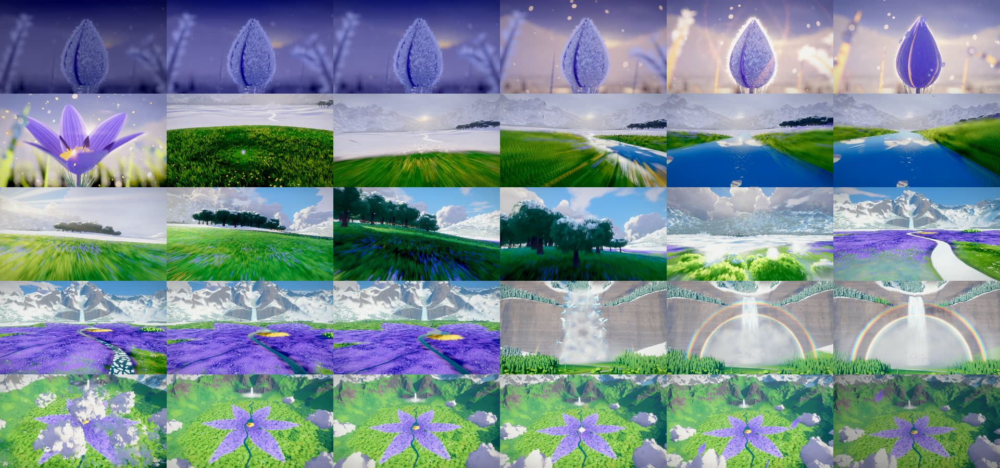

# FIRST BLOOM



This is a 30-second painterly 3D short film, 16:9 at 3840×2160 and 30 fps. It was built procedurally in three.js and rendered offline, frame by frame, in headless Chrome.

> On a frozen blue-hour meadow, one frost-rimed pasque-flower bud bursts open. The spring it releases races across a snowbound mountain basin, thaws a creek that reflects a summer sky that hasn't arrived yet, and shatters a frozen waterfall into a double rainbow. From high above, the whole valley turns out to have bloomed into the same flower.

## Watch
The films are attached to the [v1.0 release](https://github.com/Leonxlnx/first-bloom/releases/tag/v1.0):

| File | What it is |
|---|---|
| [`first_bloom_3840x2160.mp4`](https://github.com/Leonxlnx/first-bloom/releases/download/v1.0/first_bloom_3840x2160.mp4) | The 4K master. H.264 High 5.2, BT.709, CRF 16 capped at 120 Mbit/s, with AAC 320k audio (461 MB). |
| [`first_bloom_1920x1080.mp4`](https://github.com/Leonxlnx/first-bloom/releases/download/v1.0/first_bloom_1920x1080.mp4) | A 1080p version for sharing (81 MB). |
| `poster_flower.png`, `poster_bloom.png` | 4K stills: the valley-is-a-flower reveal and the bud bursting open. |
| `first_bloom_contact.jpg` | A contact sheet with one frame per second. |
| `first_bloom_v1_1920x1080.mp4` | The first cut, before the final fix round, for comparison. |




## How it's made
- **Engine** (`src/engine.js`): each output frame accumulates 10-32 jittered, time-offset subframes, which gives anti-aliasing and true motion blur. The post chain runs in this order: anisotropic Kuwahara paint filter on HDR, depth of field, a self-blurred particle overlay, physically based bloom, lens ghosts and anamorphic streak, AgX tonemap and an OKLab grade, then grain and dither.
- **World** (`src/world/`): the procedural basin terrain, baked by `bake.mjs`; a Dijkstra arrival-time field that drives the spring wave; and the modules for sky and volumetric-style clouds, meadow, trees, the hero flower, water, waterfall and rainbow, particles and birds.
- **Timing** (`src/world/timeline.js`): every beat is locked to the music edit.
- **Sound** (`mix.mjs`, `audio/cues.mjs`): a measured, cue-based mix of licensed library audio. Nothing is synthesized. See `CREDITS.md`.

The final fix round (`rerender_v2.mjs`) re-rendered only the frames its fixes touch: f201-225, f281-365 and f462-899. `src/world/timeline_v1.js` keeps the first cut's camera, so layouts sampled from the camera path at load time stay identical in the untouched frames.

## Rebuild
Needs Node 20+, ffmpeg on the PATH and Google Chrome (`render.mjs` points at its default Windows install path).
```
npm install
node bake.mjs && node bake_info2.mjs                          # world data -> data/
node audio/fetch_audio.mjs                                     # library audio from its sources
node audio/edit/render_edit.cjs audio/edit/edit_1.spec.json    # 30 s music edit
node mix.mjs audio/cues.mjs out/mix.wav                        # soundtrack
node render_all.mjs --w 3840 --h 2160 --out frames/final --mix out/mix.wav
```
The audio files are not in the repo, because the Pixabay and Mixkit licences don't allow redistributing them on their own. `fetch_audio.mjs` downloads them from the original sources.

## Licences
- **Music:** "The Light Between Moments" by MoonpetalMedia, under the Pixabay Content License. It is free for commercial use, needs no attribution, and is not registered with Content ID.
- **SFX:** CC0 recordings from Freesound and the Mixkit free licence. Full list in `CREDITS.md`.
